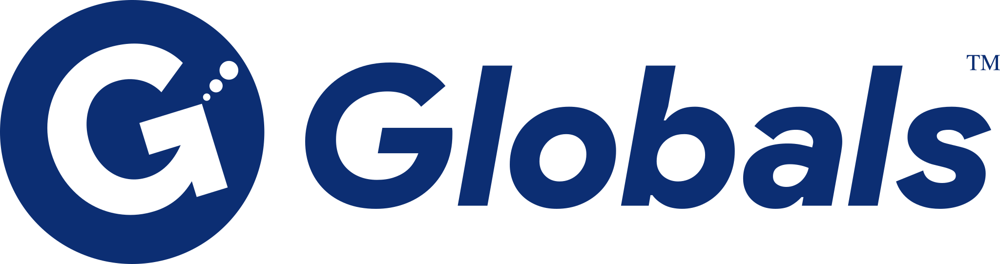

# Globals

The design system for Globals ITES — governance, risk and compliance advisory, GRC automation and security services. It keeps every Globals surface (proposals, reports, the client portal, web pages, decks) calm, precise and recognisably ours.

## Principles

- **Clarity over decoration.** Compliance is complex; our interfaces are not. One idea per block, generous space, plain words.
- **Navy leads, colour signals.** `primary` navy carries the brand. `secondary` aqua and `accent` violet are used sparingly to highlight, never to fill whole pages.
- **Proportion by φ.** Spacing, radius and the type scale all step by the golden ratio (φ ≈ 1.618), so every size relates to every other.

## Content fundamentals

- Voice: confident, advisory, plain. Write like a trusted consultant, not a vendor.
- Use sentence case for headings and buttons ("Start readiness assessment", not "Start Readiness Assessment").
- Name frameworks exactly: ISO/IEC 27001:2022, SOC 2 Type II, DPDP Act 2023, CMMC Level 2.
- Prefer verbs on actions: "Upload evidence", "Assign owner", "Export report".
- Numbers in figures; dates as `12 Nov 2026`.

## Visual foundations

### Colour

| Role | Token | Light | Use |
|---|---|---|---|
| Brand | `primary` | #0c2f73 | Primary actions, links, active states |
| Highlight | `secondary` | #92e8e5 | Tags, secondary fills, charts — never as text on light |
| Accent | `accent` | #6b5be6 | Focus rings, badges, small emphasis |
| Ink | `text` | #160f03 | All body text and headings |
| Ground | `background` | #f6fcff | Page background |

#### Colour scales

Every colour comes from a tonal ramp, steps 50 (lightest) → 950 (darkest), built in OKLCH so equal steps look evenly spaced. The brand colour is the ramp's anchor:

| Ramp | Anchor | Purpose |
|---|---|---|
| `navy-*` | `navy-900` = #0c2f73 | Brand, primary actions |
| `aqua-*` | `aqua-200` = #92e8e5 | Highlights, secondary fills |
| `violet-*` | `violet-600` = #6b5be6 | Accent, focus |
| `neutral-*` | — | Borders, muted text, chrome |
| `green-*` · `amber-*` · `red-*` | — | Success · warning · danger |

How to use them:

- **Build UI with semantic tokens** (`primary`, `border`, `text-muted`, `danger`…). Each one aliases a ramp step per theme — e.g. `primary` = `navy-900` in light, `navy-300` in dark — so changing a ramp step updates every component that uses it.
- **Use ramp steps directly** only for charts, illustrations, data states, or when defining a new semantic token.
- **Text-safe steps:** 600+ on light backgrounds, 300–400 on dark backgrounds. 50–200 are fills only.
- **Pairing:** a fill and the text on it should be ≥ 5 steps apart (e.g. `aqua-100` fill with `aqua-800` text).
- `background`, `surface` and `text` stay fixed brand values; they are not on a ramp.

Rules: text sits on `background` or `surface` in `text` or `text-muted`. On a `primary` fill use `on-primary`; on `secondary` use `on-secondary`. Status colours (`success`, `warning`, `danger`) mean state only — never decoration. Every token has a dark-theme value.

#### State colours: which ramp step for what

Red, amber and green always mean **danger / warning / success** (RAG). Pick the step by the job the colour does, not by taste:

| Job | Light | Dark | Token | Why |
|---|---|---|---|---|
| Text and icons (badge label, KPI delta, stat value, inline message) | 700 | 400 | `success` · `warning` (amber-600) · `danger` | First text-safe step with ≥ 4.5:1 on `surface`; 400 is the readable step on dark. |
| Badge / banner fill behind that text | 100 | — (use 10–15 % alpha of the 400) | `success-fill` · `warning-fill` · `danger-fill` | 100 ↔ 700 is six steps apart, so the pair passes the pairing rule. |
| Chart series, progress and meter fills, sparkline strokes | 450 | 400 (amber 300) | `chart-positive` · `chart-caution` · `chart-negative` | Half-step between 400 and 500 (green #32ac6c · amber #ce7f1b · red #ed5e51): saturated enough to read as RAG on white, lighter than the 700 text so large areas do not shout. No text sits on it. |
| Comparison series that is not a state (e.g. a baseline or "other" bucket) | neutral-400 | neutral-500 | `chart-neutral` | Keeps RAG colours reserved for meaning. |
| Border accent (unread notification edge, stat tile edge) | 700 | 400 | `success` / `warning` / `danger` as border colour | Same step as text so edges and labels match. |
| Hover / pressed on a RAG fill (danger button) | 800 | 300 | — | One step past the resting fill. |

Thresholds used across the console: **SLA** on track = success, due within 48 h = warning, overdue = danger; **limits and quotas** < 80 % success, 80–95 % warning, ≥ 95 % danger; **translation completeness** 100 % success, ≥ 60 % warning, below danger; **consent by purpose** granted = success, withdrawn = danger above the 20 % withdrawal threshold, caution at or below it; **notification severity** critical/high = danger, medium = warning, low = primary (navy, not a state). Up-trends are green only when a rise is good; withdrawals and overdue counts invert.

Never use RAG for: primary actions, links, selected rows, decorative fills, "info" (use `secondary` aqua or `accent` violet). Colour never carries meaning alone — every RAG element also has a label, arrow or number.

> Two layers: tonal ramps (navy, aqua, violet, neutral, green, amber, red; steps 50–950, built in OKLCH with the brand colour as its anchor step) and semantic tokens that alias them per theme. Build UI with semantic tokens; reach for ramp steps only for charts, illustration or a new semantic token.

#### Semantic tokens

| Token | Light | Dark | Usage |
|---|---|---|---|
| `background` | #f6fcff | #070d1a | Page background. Body text uses text (18.4:1 light, 17.5:1 dark). |
| `surface` | #ffffff | #101a2e | Cards, inputs, menus and any raised panel on background. |
| `surface-tint` | `{navy-100}` | #15233f | Selected rows, subtle highlight panels, table headers. Text on it: text. |
| `border` | `{neutral-200}` | `{neutral-800}` | Hairlines: card outlines, dividers, table rules. Decorative only, not for control boundaries. |
| `border-strong` | `{neutral-500}` | `{neutral-500}` | Input and control outlines (3:1+ against surface). |
| `text` | #160f03 | #eef4fa | Primary text and headings on background and surface. |
| `text-muted` | `{neutral-700}` | `{neutral-400}` | Secondary text: captions, helper text, metadata (6.9:1 light, 7.6:1 dark). |
| `primary` | `{navy-900}` | `{navy-300}` | Brand navy. Primary buttons, links, active nav, headings in marketing. Logo ink is #0c2e73; use this token everywhere else. |
| `primary-hover` | `{navy-800}` | `{navy-200}` | Hover and pressed state of primary surfaces. |
| `on-primary` | #ffffff | #070d1a | Text and icons on primary (12.6:1 light, 10.3:1 dark). |
| `secondary` | `{aqua-200}` | `{aqua-200}` | Aqua highlight. Secondary buttons, tags, chart series, illustration fills. Never text on light backgrounds. |
| `on-secondary` | #160f03 | #070d1a | Text on secondary (13.5:1). |
| `accent` | `{violet-600}` | `{violet-300}` | Violet accent. Focus rings, badges, small emphasis. Text in accent passes 4.7:1 on background; keep it to 14px+. |
| `on-accent` | #ffffff | #070d1a | Text on accent (4.9:1 light, 10.2:1 dark). |
| `focus-ring` | `{accent}` | `{accent}` | 2px focus outline on every interactive element. |
| `success` | `{green-700}` | `{green-400}` | Compliant, passed, completed states. |
| `warning` | `{amber-600}` | `{amber-300}` | At-risk, due-soon, needs-review states. |
| `danger` | `{red-700}` | `{red-400}` | Non-compliant, failed, destructive actions. |

#### Ramps (same in both themes)

| Step | navy | aqua | violet | neutral | green | amber | red | Usage |
|---|---|---|---|---|---|---|---|---|
| 50 | #f3f7ff | #ddfffd | #f5f6ff | #f2f7fe | #e4ffec | #fff5ec | #fff4f2 | Lightest tint: page washes, hover on light. |
| 100 | #e1ecfe | #baf9f7 | #e8e9ff | #e6ecf4 | #c4fbd6 | #fee6d0 | #ffe4e0 | Subtle fills: selected rows, tags. |
| 200 | #c3d8ff | #92e8e5 | #d1d3fe | #d1d8e2 | #a4ebbc | #fecd9e | #fec9c1 | Soft fills, light borders. |
| 300 | #9bbefd | #63d3d0 | #b4b6fe | #b5bfcb | #7bd49c | #f6ac60 | #ffa194 | Decorative fills; foreground on dark theme. |
| 400 | #72a0f6 | #1bb8b5 | #9592fe | #98a3b0 | #4dba7b | #df8c27 | #fb6f61 | Icons and graphics; dark-theme foreground. |
| 500 | #5483dd | #069a97 | #7a6ef8 | #7c8795 | #179f5d | #bd720f | #e04c41 | Mid tone: charts, illustration. |
| 600 | #3c6bc3 | #037f7d | #6b5be6 | #65707d | #03844b | #9d5e0a | #c52c26 | Text-safe on light (≥4.5:1). |
| 700 | #2753a7 | #086564 | #503abf | #4f5966 | #07693b | #7e4a03 | #a7060c | Strong text and fills on light. |
| 800 | #163d88 | #004d4c | #3d239e | #3a434e | #05502c | #603702 | #800407 | Hover/pressed on dark fills. |
| 900 | #0c2f73 | #013635 | #2b0e79 | #272e38 | #01381d | #442500 | #5c0103 | Deep fills, headings. |
| 950 | #011545 | #00201f | #190053 | #161b22 | #00220f | #2a1500 | #3a0001 | Darkest: dark-theme tints and shadows. |

Ramp notes: navy — brand navy ramp, 900 = brand primary (#0c2f73). aqua — 200 = brand secondary (#92e8e5). violet — 600 = brand accent (#6b5be6). neutral — cool grey ramp for borders, muted text and UI chrome. green — success ramp. amber — warning ramp. red — danger ramp.

### Typography

Inter, one family for everything (Google Fonts: weights 400, 600, 700). The scale is 16px × φ^(n/2): 10 · 13 · 16 · 20 · 26 · 33 · 42 · 68. Body line height is size × φ (16 → 26px). Headings use 600–700 with slight negative tracking; never use weights below 400.

Family `sans`: `"Inter", system-ui, -apple-system, "Segoe UI", Roboto, sans-serif`

| Group | Style | Size | Line height | Weight | Tracking | Sample | Usage |
|---|---|---|---|---|---|---|---|
| Display | `display` | 68px | 1.05 | 700 | -0.03em | Compliance, made clear | Hero headlines only. 16 × φ³. |
| Display | `h1` | 42px | 1.15 | 700 | -0.02em | ISO 27001 readiness | Page titles. 16 × φ². |
| Display | `h2` | 33px | 1.2 | 600 | -0.015em | Controls overview | Section titles. 16 × φ^1.5. |
| Display | `h3` | 26px | 1.25 | 600 | -0.01em | Access management | Sub-sections, card titles in reports. 16 × φ. |
| Display | `h4` | 20px | 1.3 | 600 | — | Evidence collected | Card and panel titles. 16 × √φ. |
| Text | `body-lg` | 20px | 32px | 400 | — | We help teams reach certification with less effort. | Lead paragraphs. Line height = size × φ. |
| Text | `body` | 16px | 26px | 400 | — | Every control is mapped, owned and evidenced. | Default text. 16px base, 26px (16 × φ) line height. |
| Text | `label` | 13px | 21px | 600 | 0.01em | Control owner | Buttons, form labels, table headers. 16 ÷ √φ. |
| Text | `body-sm` | 13px | 21px | 400 | — | Last reviewed 12 Nov 2026 | Helper text, captions, metadata. |
| Text | `overline` | 10px | 16px | 600 | 0.08em | FRAMEWORK | Uppercase eyebrows above titles only. 16 ÷ φ. Never for running text. |

### Spacing

`space-1`…`space-8` = 4 · 6 · 10 · 16 · 26 · 42 · 68 · 110px — each step ≈ the previous × 1.618. Pad cards with `space-5`, separate sections with `space-6`, give heroes `space-7`/`space-8`. Pick the next step up or down; never use in-between values.

> Golden-ratio scale: each step ≈ previous × 1.618, rounded to whole pixels (the Fibonacci-like 4, 6, 10, 16, 26, 42, 68, 110). Base = 16px.

| Token | Value | Usage |
|---|---|---|
| `space-1` | 4px | Icon-to-label gap, tight inline gaps. |
| `space-2` | 6px | Gaps inside chips and badges; stacked label-to-input. |
| `space-3` | 10px | Button vertical padding, gap between related controls. |
| `space-4` | 16px | Base unit. Button horizontal padding, list item spacing, form field gaps. |
| `space-5` | 26px | Card padding, gap between cards in a grid. |
| `space-6` | 42px | Gap between content sections inside a page. |
| `space-7` | 68px | Section padding on marketing pages and report cover blocks. |
| `space-8` | 110px | Hero and page-level vertical rhythm. |

### Radius

`radius-sm` 4 · `radius-md` 6 · `radius-lg` 10 · `radius-xl` 16 · `radius-2xl` 26 · `radius-full`. Controls use `radius-md`, cards `radius-lg`, modals `radius-xl`. Nested corners: inner radius = outer radius one step down.

> Golden-ratio radii: 4 × φⁿ, rounded.

| Token | Value | Usage |
|---|---|---|
| `radius-sm` | 4px | Badges, tags, checkboxes, table cells. |
| `radius-md` | 6px | Buttons, inputs, selects. |
| `radius-lg` | 10px | Cards, menus, popovers. |
| `radius-xl` | 16px | Modals, large panels, feature tiles. |
| `radius-2xl` | 26px | Hero media and marketing containers. |
| `radius-full` | 9999px | Pills, avatars, status dots. |

### Surfaces and elevation

Separate with `border` hairlines first; add `shadow-sm`/`shadow-md` only for things that float (menus, hovered cards, dialogs use `shadow-lg`). No gradients.

| Token | Light | Dark | Usage |
|---|---|---|---|
| `shadow-sm` | `0 1px 2px rgba(12,47,115,0.08)` | `0 1px 2px rgba(0,0,0,0.5)` | Inputs, resting cards. |
| `shadow-md` | `0 4px 16px rgba(12,47,115,0.10)` | `0 4px 16px rgba(0,0,0,0.55)` | Menus, popovers, hovered cards. |
| `shadow-lg` | `0 10px 42px rgba(12,47,115,0.14)` | `0 10px 42px rgba(0,0,0,0.6)` | Modals and dialogs. |

## Logo

Two versions in **Assets → Logos**: full colour (navy `#0c2e73`) for light backgrounds, white for `primary` navy or photography. Keep clear space of at least the height of the "G" mark's inner dot cluster (≈ ¼ of the logo height) on every side; minimum width 120px on screen. Never recolour, stretch, add effects or place the colour logo on dark or busy backgrounds.

Files: [apps/web/public/logos/](../apps/web/public/logos/)



- `globals-logo-color.svg` — full-colour lockup, ink #0c2e73. Use on `background`, `surface` or white.
- `globals-logo-white.svg` — single-ink white lockup. Use on `primary` navy, dark theme surfaces or photography.

Both are 3503 × 926 (≈ 3.78 : 1). Scale proportionally; minimum 120px wide on screen, 30 mm in print. Clear space ≥ ¼ of the logo height on all sides.

## Iconography

No icon set is supplied yet. Until one is chosen, use a single outline set at 1.5px stroke, 16/20/24px sizes, coloured `text` or `text-muted` (or `on-primary` on navy). Do not mix icon styles.

## Components

- **Button** — primary, secondary, ghost and danger variants (`.gl-btn`).
- **Card** — surface container for summaries and metrics (`.gl-card`).

Classes live in `components/bundle.css` and read only tokens.

### Button

Triggers an action; use `.gl-btn` plus one variant class.

- `gl-btn--primary` — the single main action on a view.
- `gl-btn--secondary` — supporting positive actions (aqua fill).
- `gl-btn--ghost` — tertiary actions, cancel, navigation.
- `gl-btn--danger` — destructive actions only.
- Sizes: `gl-btn--sm`, default, `gl-btn--lg`. Radius `radius-md`, padding `space-3`/`space-4`.

Labels are sentence case verbs. The consumer provides the label and handler; focus ring uses `focus-ring`.

```html
<button class="gl-btn gl-btn--primary">Start assessment</button>
<button class="gl-btn gl-btn--secondary">Upload evidence</button>
<button class="gl-btn gl-btn--ghost">View controls</button>
<button class="gl-btn gl-btn--danger">Revoke access</button>
<button class="gl-btn gl-btn--primary gl-btn--sm">Small</button>
<button class="gl-btn gl-btn--primary" disabled>Disabled</button>
```

### Card

A surface container that groups one summary, metric or item; use `.gl-card`.

Parts: `gl-card__eyebrow` (overline style), `gl-card__title` (h4), `gl-card__body`, optional `gl-card__tag` (aqua). Padding `space-5`, radius `radius-lg`, `border` hairline and `shadow-sm`. Grids of cards gap by `space-5`. The consumer provides the content.

```html
<div class="gl-card">
  <p class="gl-card__eyebrow">ISO/IEC 27001:2022</p>
  <h4 class="gl-card__title">Readiness 82%</h4>
  <p class="gl-card__body">76 of 93 Annex A controls implemented and evidenced.</p>
</div>
<div class="gl-card">
  <p class="gl-card__eyebrow">DPDP Act 2023</p>
  <h4 class="gl-card__title">Consent records</h4>
  <p class="gl-card__body">Notices reviewed for all processing purposes.</p>
  <span class="gl-card__tag">In review</span>
</div>
```

### bundle.css

```css
/* Globals components — read tokens only */
.gl-btn{display:inline-flex;align-items:center;justify-content:center;gap:var(--space-2);padding:var(--space-3) var(--space-4);border-radius:var(--radius-md);border:1px solid transparent;font-family:var(--font-sans);font-size:13px;line-height:21px;font-weight:600;letter-spacing:.01em;cursor:pointer;transition:background .15s,border-color .15s}
.gl-btn:focus-visible{outline:2px solid var(--focus-ring);outline-offset:2px}
.gl-btn--primary{background:var(--primary);color:var(--on-primary)}
.gl-btn--primary:hover{background:var(--primary-hover)}
.gl-btn--secondary{background:var(--secondary);color:var(--on-secondary)}
.gl-btn--ghost{background:transparent;color:var(--primary);border-color:var(--border-strong)}
.gl-btn--ghost:hover{background:var(--surface-tint)}
.gl-btn--danger{background:var(--danger);color:var(--on-primary)}
.gl-btn--sm{padding:var(--space-2) var(--space-3)}
.gl-btn--lg{padding:var(--space-4) var(--space-5);font-size:16px;line-height:26px}
.gl-btn[disabled]{opacity:.45;cursor:not-allowed}

.gl-card{background:var(--surface);border:1px solid var(--border);border-radius:var(--radius-lg);padding:var(--space-5);box-shadow:var(--shadow-sm);color:var(--text);font-family:var(--font-sans)}
.gl-card__eyebrow{font-size:10px;line-height:16px;font-weight:600;letter-spacing:.08em;text-transform:uppercase;color:var(--text-muted);margin:0 0 var(--space-2)}
.gl-card__title{font-size:20px;line-height:1.3;font-weight:600;margin:0 0 var(--space-3)}
.gl-card__body{font-size:16px;line-height:26px;color:var(--text-muted);margin:0}
.gl-card__tag{display:inline-block;padding:2px var(--space-2);border-radius:var(--radius-sm);background:var(--secondary);color:var(--on-secondary);font-size:13px;line-height:21px;font-weight:600}
```
